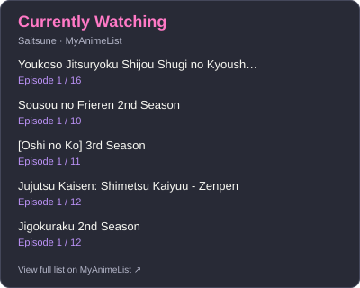

<h2 data-importer="text" align="left">Hi 👋! My name is Wiktor (or you can call me Saitsune)  I build games, the fun tools for gaming, and websites for everything in between.</h2>

###

  
  

###

  
  
  
  
  
  
  
  
  
  
  
  
  
  
  
  
  
  
  
  
  
  
  
  
  
  
  
  
  
  
  
  
  

###

  

###

<picture data-importer="pacman">
  <source media="(prefers-color-scheme: dark)" srcset="https://raw.githubusercontent.com/itssaitsune/itssaitsune/pacman-output/pacman-contribution-graph-dark.svg?game=pacman">
  <source media="(prefers-color-scheme: light)" srcset="https://raw.githubusercontent.com/itssaitsune/itssaitsune/pacman-output/pacman-contribution-graph.svg?game=pacman">
  
</picture>

###

 

  
  

###

<table align="center">
  <tr>
    <td align="center" valign="top" width="50%">
      
    </td>
    <td align="center" valign="top" width="50%">
      
    </td>
  </tr>
</table>

###

  

###
